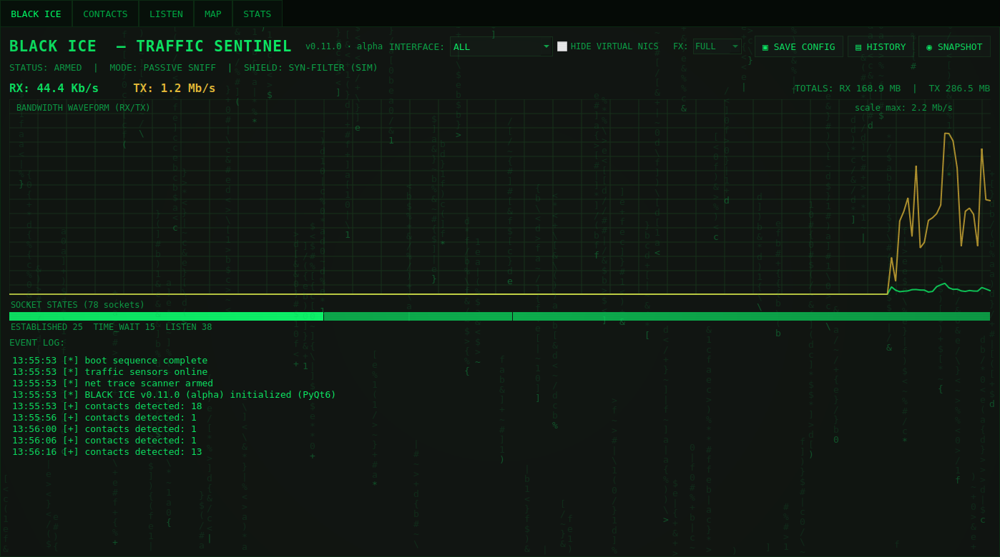
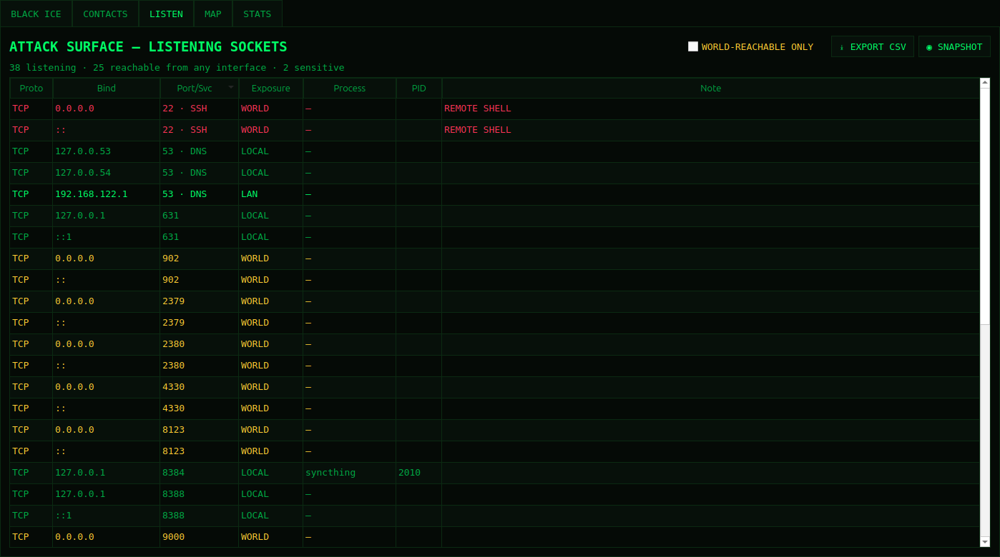
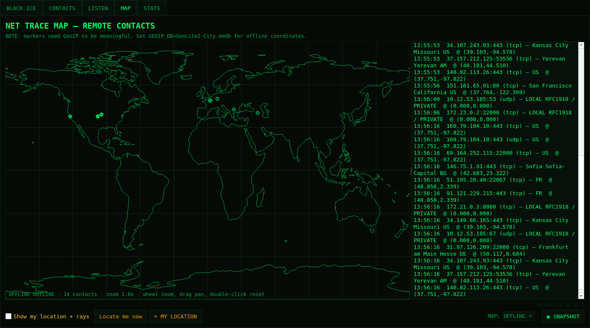

# BLACK ICE - Traffic Visualizer

Minimal hacker‑style network traffic visualizer for Linux, built with **Python + PyQt6**.

Green‑phosphor UI, scanlines, matrix rain, live bandwidth waveform, and a world map
showing your remote connections — with optional **"my location"** marker and rays.


WARNING: this __not__ a hack tool, just a educational project made just 4fun





---
## Features

- Old‑school **BLACK ICE / cyberpunk** interface  :) 
- Live RX/TX bandwidth (per interface or total)  
- **Socket state histogram** — ESTABLISHED / SYN_SENT / TIME_WAIT / CLOSE_WAIT at a glance
- Event console (connections discovered in real time)  
- **CONTACTS tab** — sortable/filterable table of remote endpoints, with connection
  state, reverse‑DNS hostname, **RX/TX bytes actually moved**, watchlist flags, a
  right‑click menu and CSV/JSON export
- **LISTEN tab** — what this host is *accepting* on, TCP **and UDP**: bind address,
  owning process and an exposure class (WORLD / LAN / LOCAL), with sensitive
  world‑reachable ports called out, a *world-reachable only* filter and CSV export.
  This is the set `ss -ltun` reports — UDP sockets have no LISTEN state, but a bound
  UDP port still receives from whatever its bind address lets in
- **World map**, offline by default — a bundled 10 KB coastline outline drawn natively
  (wheel to zoom, drag to pan, double‑click to reset); Leaflet/OpenStreetMap still
  available as an ONLINE mode
- Optional **My Location** marker and **rays** from you to remote contacts
- **⌖ MY LOCATION** button — geolocates you in the background and flies the map to your position
- **STATS tab** — bandwidth history plus top countries, top networks (ASN) and
  **top talkers in real bytes**: `ss -tinp` exposes the kernel's own per-socket
  `bytes_sent`/`bytes_received` next to the owning pid, so the ranking is actual
  TCP traffic rather than a count of endpoints. Falls back to endpoint counts
  where `ss` is unavailable, and the panel title always says which it is showing
- **Port-change alerts** — a socket that was not listening a moment ago is called
  out in the event log, and a newly world-reachable sensitive port raises the banner.
  Sockets on ephemeral ports (the kernel's own `ip_local_port_range`) are listed but
  not announced: an outbound-heavy client churns several a minute, and an alert
  channel that cries wolf is one nobody reads
- **HISTORY tab** — browse, filter and export what the history database has recorded
  across earlier runs, including how long this machine has been watched and over how
  many sessions (only when recording is on)
- **Per-process behavioural baseline** — with history on, the app learns which networks
  and countries each program normally talks to, and flags a contact that falls outside
  its own habits. Your machine's record, checkable offline; no feed to go stale
- **Beacon detection** — endpoints contacted on a metronome are reported with their
  measured period and jitter
- **Forward-confirmed reverse DNS** — a PTR name that does not resolve back to the
  address it came from is flagged
- **Socket-health alerts** — a climbing pile of `CLOSE_WAIT` (a process leaking sockets)
  or `SYN_SENT` (connections not completing) says so instead of just drawing a bar
- **ASN clustering on the map** — zoomed out, contacts roll up into one marker per
  owning network; zoom past 3× to split them back into individual endpoints
- **Watchlist rules** — your own CIDR / port / ASN / country / process / host rules
  flag matching contacts red and raise an alert banner
- **▤ HISTORY** toggle — optional, off by default: records contacts and bandwidth to a
  local SQLite database so they survive a restart, and marks endpoints never seen
  before as **NEW**
- **HIDE VIRTUAL NICS** — keep docker/veth/bridge/tunnel interfaces out of the totals
- **FX** intensity — OFF / SUBTLE / FULL for the matrix rain and scanlines
- **Snapshot button** on every tab — save the current view as PNG
- **▭ TRAY** — keep watching when the window is closed; the icon grows a red pip
  while anything is flagged. A sentinel that stops when you close it is not a sentinel
- **⏸ FREEZE** — hold the tables, graphs and map still so you can actually read them.
  Scanning, recording and the event log carry on underneath
- **SCAN interval** — 1s to 30s. Every scan walks `/proc`, so a longer interval is
  cheaper on a busy host or a battery
- **Click any STATS rollup** to filter the contact table to that process, network or
  country
- **Right-click a contact → Copy firewall rule** — `nftables`, `iptables` or `ufw`, with
  the address family and flag order already right. Copied as text; nothing is applied
- **▣ SAVE CONFIG** toggle — optional, off by default: remembers window geometry, open tab and layout between runs
- **Headless mode** — `--headless` scans and exports without a GUI; `--selftest` checks itself
- Offline GeoIP support (MaxMind GeoLite2)  
- No packet sniffing by default (psutil‑based, safe mode)
---

## Requirements

- Linux/Windows*
- Python 3.9+
- PyQt6
- psutil

Optional:
- `PyQt6-WebEngine` — only for the MAP tab's **ONLINE** (Leaflet) mode; the default
  offline map is drawn natively and works without it
- `geoip2` + `GeoLite2-City.mmdb` for offline geolocation
- `GeoLite2-ASN.mmdb` for the ASN/Org column and the TOP NETWORKS rollup

---

## Install

```bash
python3 -m venv .venv
source .venv/bin/activate

pip install PyQt6 psutil
# optional: the ONLINE (Leaflet) map mode
pip install PyQt6-WebEngine
# optional offline GeoIP
pip install geoip2
```

---

## Run

```bash
python3 blackice_traffic.py
```

With offline GeoIP:

```bash
GEOIP_DB=/path/to/GeoLite2-City.mmdb python3 blackice_traffic.py
```

An ASN database is picked up the same way (`ASN_DB=/path/to/GeoLite2-ASN.mmdb`);
without it the ASN/Org column and the TOP NETWORKS rollup stay empty.

## Command line

```bash
python3 blackice_traffic.py --selftest
python3 blackice_traffic.py --headless --duration 60 --export contacts.csv

# one JSON object per scan, for jq or a log shipper
python3 blackice_traffic.py --json --duration 3600 | jq -c 'select(.listeners_opened != [])'

# run until stopped; exit 3 on a watchlist hit, 4 on a port newly open to the world
python3 blackice_traffic.py --watch --notify --duration 0
```

`--watch` exit codes: `0` nothing flagged, `2` error, `3` watchlist hit, `4` a sensitive
port became reachable from any interface. An exposure outranks a watchlist hit — a port
that just opened to the world is news about this machine, not about a list.

| flag | meaning |
| --- | --- |
| `--headless` | scan without a GUI, print a summary, optionally export |
| `--duration N` | how long `--headless` keeps scanning (default 10s) |
| `--interval N` | seconds between scans (default 3) |
| `--export PATH` | write contacts to PATH — `.json` for JSON, anything else CSV |
| `--json` | stream one NDJSON record per scan to stdout (implies `--headless`) |
| `--watch` | implies `--headless`; exit 3 on a watchlist hit, 4 on a newly world-reachable sensitive port. With no positive `--duration`, runs until interrupted |
| `--notify` | desktop notification (`notify-send`) for anything `--watch` flags |
| `--resolve` | reverse‑DNS every contact (slower) |
| `--watchlist PATH` | use a different rules file |
| `--selftest` | run internal checks and exit non‑zero on failure |
| `--version` | print the version and exit |

## Flags column

| flag | meaning |
| --- | --- |
| `NEW` | address never seen in an earlier session |
| `⚑LABEL` | matched one of your watchlist rules |
| `⚠AS… NEW FOR <proc>` | outside this program's learned habits |
| `◷BEACON ~300s ±2s ×14` | contacted on a regular timer |
| `?PTR` | the hostname does not resolve back to this address |

## Watchlist

Rules live in a plain, hand‑editable file next to the config:

```
~/.config/blackice/watchlist.txt
```

One rule per line, `#` starts a comment:

```
cidr      185.220.100.0/22   TOR EXIT RANGE
port      3389               RDP
asn       AS13335            CLOUDFLARE
country   RU
process   nc
host      .example.com
```

Matching contacts turn red, get the rule's label in the **Flags** column, and raise the
alert banner on the BLACK ICE tab. Nothing here is downloaded or updated: a bundled
"known bad" list would be stale the day it shipped and unverifiable offline, so the
rules are yours alone. Press **✎ EDIT RULES** to edit the file in-app — it parses on
every keystroke and names the line number of anything malformed before you save —
**⚑ RULES** to reload it after editing it elsewhere (the reload is retroactive), or
right‑click a contact to append a rule for it.

## History

**▤ HISTORY** is off by default and nothing is written until you turn it on. With it on,
contacts and a once‑a‑minute bandwidth sample are recorded to:

```
~/.local/share/blackice/history.db
```

The addresses already in that database form a baseline, so an endpoint this machine has
never contacted before is flagged **NEW** for the session — private, loopback and
link-local addresses are never flagged, so your own LAN does not drown the signal.
Rows older than 30 days are dropped on startup. Turning the toggle off closes the
database and stops recording. The **HISTORY** tab shows what is in there — sortable,
filterable, exportable to CSV, with a **⌫ FORGET ALL** button that empties it.

Building on a fresh machine
-------------

Two system packages and one command:

```bash
sudo apt-get install build-essential dpkg-dev python3-venv python3-pip
make deb
```

The build creates `./.venv` from `requirements.txt` on first run (PyInstaller
lives there, not on the system Python) and drops the `.deb` in `build/`.
`make bin` stops after the standalone binary. `make distclean` removes the
venv along with the build output.

The MaxMind `GeoLite2-City.mmdb` / `GeoLite2-ASN.mmdb` databases are not
redistributable and are not in the repository. If you drop them in the project
root before building they get bundled into the package; without them the build
succeeds and the geolocation columns stay empty.

To build against an interpreter you manage yourself, point `PYTHON=` at it —
the build then never touches `.venv` and fails if PyInstaller is missing there.
`NO_BOOTSTRAP=1` disables the automatic venv creation entirely.

Building deb package
------------- 

Install required packages:
```
sudo apt-get install git devscripts build-essential lintian upx-ucl
```
Run build:
```
make deb        # or: ./build_linux_bin.sh && ./build_deb.sh
```

Building linux binary (PyInstaller) 
------------- 
Run build:
```
./build_linux_bin.sh
```

Building Windows binary (PyInstaller) 
------------- 
Run build:
```
./build_win.cmd
```

---

## Configuration (optional)

Saving is **off by default** — out of the box the app writes nothing and always
starts from its defaults.

Press **▣ SAVE CONFIG** in the top bar of the BLACK ICE tab to turn it on. From
then on the following is restored on the next launch:

- window geometry and maximized state (re-centered if the saved monitor is gone)
- the selected tab
- the interface picked on the BLACK ICE and STATS tabs, and the STATS time window
- the CONTACTS column widths, sort column/direction and filter text
- the MAP splitter position, map mode, the *Show my location + rays* checkbox and
  the *Cluster by ASN* checkbox
- the FX intensity, the hide-virtual-NICs switch, and the LISTEN tab's filter and
  column widths
- whether history recording was on, whether the tray was on, and the scan interval

The FREEZE state is deliberately *not* restored: starting up already frozen would look
exactly like a tool that is not working.

State lives in a plain, hand-editable INI file:

```
~/.config/blackice/blackice_traffic.ini
```

Turning the toggle off deletes every stored key (the flag itself stays, so the
app knows not to restore). Deleting the file by hand has the same effect.

---

## Map notes

- **OFFLINE** (the default) draws a bundled Natural Earth 1:110m coastline —
  119 rings, 2505 points, 10 KB in `resources/world.bin` — with no network access at
  all. **ONLINE** adds OpenStreetMap tiles, which does reach the internet.
- Leaflet is **vendored** in `resources/leaflet` (BSD-2-Clause, licence included) and
  inlined into the page. It used to be fetched from a CDN on every launch, which is a
  third party able to change code running inside a security tool. Only the map tiles
  still come from the network; if the vendored copy is missing the app falls back to
  the CDN and says so.
- Zoomed out, markers are rolled up by ASN — forty endpoints in one datacentre draw
  as one circle labelled with its count. Zoom past 3× (or untick *Cluster by ASN*)
  for individual endpoints. Contacts with no ASN cluster by a coarse geographic cell
- Private and Docker IPs are labeled as **LOCAL**; loopback contacts are dropped by
  the scanner rather than shown
- Connections without coordinates are not placed on (0,0)
- "My location" is optional and can be toggled in the MAP tab

---

## Tests

```bash
make test        # or: QT_QPA_PLATFORM=offscreen python3 -m unittest discover -s tests
```

### End-to-end tests (hermetic)

```bash
make test-e2e    # needs docker; see tests/e2e/README.md
```

The unit suite learns about the socket table from a mock, which proves the code
handles the records it is given but not that those records look like what the
kernel produces. That gap is where the bugs have actually been: UDP listeners
were missing from the LISTEN tab for a whole release because a mocked `status`
said `LISTEN` and a real one says `NONE`.

The end-to-end suite runs the app inside a container with `--network none`, so
`psutil.net_connections()` returns **exactly the sockets the test opened** rather
than the ~200 a real desktop has. Nothing is mocked: it opens real sockets, moves
a known 200,000 bytes and asserts the `ss`-derived RX/TX figure matches to the
byte, drives `--watch` to each of its exit codes off real port changes, and checks
history and config survive a `SIGKILL`. It runs twice — once as root and once as
`nobody` — because the process-attribution story differs between them.

These tests skip outside the container, so neither suite needs the other and
Docker is not required to develop.

## What it does not do

The status line on the BLACK ICE tab reports the capabilities actually loaded, and
nothing else. In particular this tool does **not** capture packets — everything it
shows comes from the kernel socket table via psutil, plus `ss` for per-process byte
counters. It does not filter, block or shape traffic. Per-process bytes are TCP
only (`tcp_info` has no UDP equivalent), sockets owned by other users are counted
under *(other users)* unless you are root, and a socket that opens and closes
between two scans is missed.

The firewall rules in the right-click menu are generated as **text on your clipboard**
and nothing more. This tool reports; it does not touch the network, and the gap between
"here is the rule" and "I ran it for you" is the whole disclaimer.

Mapping a socket to the process that owns it means reading `/proc/<pid>/fd`, which
is permitted only for your own processes. Run unprivileged, roughly half the Process
column comes back blank; the status line says what share could not be attributed, so
a blank cell reads as *not permitted to know* rather than *no process*.

The behavioural baseline needs history recording on, and judges only programs it has
at least 20 recorded contacts for. Beacon periods below about 45 seconds are not
reported at all: a connection that simply stays open is re-seen on the scanner's own
20-second cycle, which is a perfect rhythm that means nothing, and the two cannot be
told apart. A reported period is a measurement, not an accusation — a software updater
polling every ten minutes looks exactly like a beacon.

Turning on *Show my location* — including restoring it from a saved config — sends
your public IP to `ifconfig.co` / `ipapi.co`. The app says so in the event log when
it happens. Nothing else here reaches the network unless you switch the map to
ONLINE mode.

## Disclaimer

This tool is **visualization only**.
It does not block traffic, inject packets, or perform intrusion (not yet).
The LISTEN tab reports your own machine's listening sockets; it does not scan anyone.
Use responsibly ;).

---

> BLACK ICE DEFENDER — observe the net.
